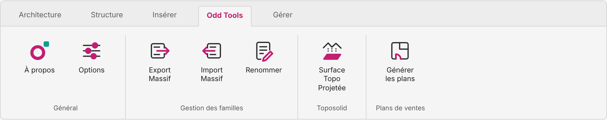

  

<h1 align="center"><b>Odd</b> Tools</h1>

  Des outils Revit simples, rapides et sur mesure. 
  <a href="https://odd-tools-dev.github.io/site/"><b>Voir le site</b></a>

  <picture>
    <source media="(prefers-color-scheme: dark)" srcset="assets/ruban-sombre.png">
    
  </picture>

Odd Tools ajoute un onglet à Revit (2021 à 2027) pour les tâches répétitives des projets BIM. Plans de ventes et Topographie : à partir de Revit 2025.

| Outil | Ce qu'il fait |
|---|---|
| **Plans de ventes** | Crée, pour chaque logement, une vue de plan orientée selon la porte d'entrée, une nomenclature et une feuille. |
| **Gestion des familles** | Export et import massifs de familles, avec gestion des doublons, et renommage en lot des familles et de leurs types. |
| **Surface Topo Projetée** | Calcule la surface projetée au sol des Toposolids et l'écrit dans un paramètre. |

Les fenêtres suivent le thème de Revit, ou un thème clair ou sombre au choix, et existent en français et en anglais.

**Version 0.13 Beta.** Les installateurs ne sont pas encore publics.

Contact : [odd.tools.dev@gmail.com](mailto:odd.tools.dev@gmail.com)
